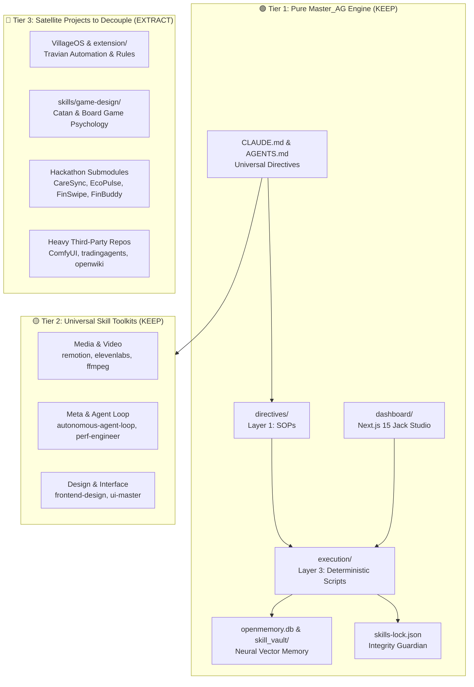

# Master_AG Architecture, Skills Taxonomy & Separation Roadmap

An exhaustive audit of the Master_AG repository topology, skills taxonomy, and modular dependencies. This document defines the boundary between the **Core Autonomous Engine (Tier 1)**, **Domain Toolkits (Tier 2)**, and **Sample Projects / Monorepo Bloat (Tier 3)** to enable a surgical separation.

---

## 🗺️ High-Level System Topology



---

## 📂 Repository Inventory & Retention Classification

| Component | Path | Description / Purpose | Footprint | Recommendation | Target Home |
| :--- | :--- | :--- | :--- | :--- | :--- |
| **Directives** | `directives/` | Layer 1 SOPs defining intent and parameters | ~30 files | **KEEP (Core)** | `Master_AG/directives` |
| **Execution** | `execution/` | Layer 3 deterministic Python tools | ~68 files | **REFACTOR** | `Master_AG/execution` (prune domain scripts) |
| **Memory Matrix** | `openmemory.db` / `skill_vault/` | SQLite vector DB & Deep Lake embeddings | ~20 MB | **KEEP (Core)** | `Master_AG/` |
| **Config & Identity** | `CLAUDE.md`, `AGENTS.md`, `GEMINI.md` | Universal agent system prompts & rules | ~4 files | **KEEP (Core)** | `Master_AG/` |
| **Lockfile** | `skills-lock.json` | Hash integrity lock for verified skills | 1 file | **KEEP (Core)** | `Master_AG/` |
| **Jack Dashboard** | `dashboard/` | Next.js 15 admin UI for memory, audio, video | Large | **REFACTOR** | `Master_AG/dashboard` (strip vertical routes) |
| **Design System** | `design-system/` | UI/UX design tokens and style guides | ~15 files | **KEEP (Core)** | `Master_AG/design-system` |
| **VillageOS (Travian)** | `VillageOS/` + `extension/` | Travian OCR, slot uploader, extension | Large | **EXTRACT** | Standalone repo: `VillageOS` |
| **Travian Rules** | `.agents/skills/travian_rules` | Travian game mechanics & slot formulas | 1 skill | **MOVE** | Into `VillageOS/skills/` |
| **Catan / Game Design** | `skills/game-design*/` | 146+ files on game psychology & loops | 146 files | **EXTRACT** | Standalone repo: `GameDesign-OS` |
| **Health Hackathon** | `CareSync-AI/` | Healthcare AI prototype (submodule) | Large | **REMOVE/ARCHIVE** | Standalone repo or delete submodule |
| **Climate Hackathon** | `EcoPulse-AI/` | Sustainability prototype (submodule) | Large | **REMOVE/ARCHIVE** | Standalone repo or delete submodule |
| **Finance Hackathons** | `FinSwipe/`, `FinBuddy*/`, `finbuddy` | Financial literacy swipe apps (submodules) | Large | **REMOVE/ARCHIVE** | Standalone repo: `FinBuddy-Suite` |
| **ComfyUI Submodule** | `ComfyUI/` | Local ComfyUI image/video node setup | Multi-GB | **EXTRACT/GITIGNORE** | Local standalone / separate tool |
| **Trading Agents** | `tradingagents/` | Market agent framework clone | Medium | **EXTRACT** | Standalone repo: `TradingAgents` |
| **OpenWiki** | `openwiki/` | Embedded documentation knowledge base | Medium | **EXTRACT** | Standalone repo: `OpenWiki` |
| **Junction** | `.claude/skills` | Windows filesystem junction to `skills` | 0 MB | **KEEP (Core)** | Kept via local junction |

---

## 🧠 Skills Taxonomy & Classification

The skill ecosystem exists in three layers: Workspace Local (`skills/`), Legacy/Staging (`.agent/`, `.agents/`), and User Global (`~/.claude/skills/`, `~/.gemini/skills/`).

### 1. Active Workspace Skills (`skills/`)
Currently contains **27 categories** (~314 files):

```
skills/
├── 🟢 CORE AUTOMATION & AGENTIC
│   ├── autonomous-agent-loop/        # Autonomous iteration protocol
│   ├── document-visualization-evaluator/ # Visual QA pipeline
│   ├── repo-analyzer/                # Structural repo diagnostics
│   └── package-skills/               # Packaging utilities
│
├── 🟢 MEDIA & SYNTHESIS SUITE (Recently Promoted)
│   ├── remotion/                     # Programmatic React video rendering
│   ├── remotion-official/            # Full official Remotion rule library
│   ├── elevenlabs/                   # Voice cloning & TTS API
│   ├── acestep/                      # Programmatic audio generation
│   ├── ffmpeg/                       # Transcoding & filter graph workflows
│   ├── moviepy/                      # Python video timeline editing
│   ├── ltx2/                         # AI video generation
│   ├── qwen-edit/                    # Vision-language image/video edit
│   └── runpod/                       # Serverless GPU dispatch
│
├── 🟢 INTERFACE & TEST CRAFT
│   ├── frontend-design/              # Anti-slop UI aesthetics & craft
│   ├── 3d-websites/                  # Three.js / WebGL architecture
│   ├── 3d-websites-settings/         # 3D canvas configuration
│   ├── ghost_cms/                    # Headless publishing
│   └── playwright-recording/         # E2E browser session recording
│
└── 🔴 EXTRACTABLE DOMAIN SUITES
    ├── game-design/                  # 139 files: Psychology, Catan, Fogg behavior
    ├── game-design-brainstorm-methods/
    ├── game-design-core-loop-extractor/
    ├── game-design-creative-unblocker/
    ├── game-design-design-pillars-extractor/
    ├── game-design-failure-loop-audit/
    └── game-design-systematizing-empathizing-audit/
```

### 2. Legacy & Staging Skills
- **`.agents/skills/travian_rules/`**: Travian building formulas, hero stats, OCR mapping. Target: Move to `VillageOS`.
- **`.agent/skills/staging/toolkit-skills/`**: Staging area for tools. The 11 active tools were promoted to `skills/`. This directory can now be pruned.

### 3. Global Skills (`~/.gemini/skills` & `~/.claude/skills`)
- **`~/.gemini/skills`**: 4,631 audited reference skills across engineering, design, ops, security, and data.
- **`~/.claude/skills`**: 57 high-density modules including `agent-browser`, `find-skills`, `graphify`, `improve`, and `seo`.

---

## 🎯 Separation Blueprint: Step-by-Step

### Phase 1: Decouple Travian & VillageOS
VillageOS is a complete product with its own Next.js frontend, Chrome extension, AppScript, and game rules. It should live in its own repository.

1. **Extract Directory**:
   - `VillageOS/` (frontend web, sheets, appscript, docs)
   - `extension/` (Chrome extension)
   - `.agents/skills/travian_rules/` (game rules skill)
2. **Prune Execution Scripts**:
   - Move `execution/find_croppers.py` -> `VillageOS/execution/`
   - Move `execution/generate_villageos_sheets.py` -> `VillageOS/execution/`
3. **Clean Dashboard Routes**:
   - Delete remnants of VillageOS sync endpoints (already migrated to `VillageOS/web`).

### Phase 2: Decouple Catan & Game Design Suite
The game design suite contains 146+ files analyzing player motivation (Bartle, Big Five), core loops, and board game mechanisms. It is a standalone knowledge base.

1. **Target**: New repository `GameDesign-Skills` or standalone submodule.
2. **Directories to Move**:
   - `skills/game-design/`
   - `skills/game-design-*/` (all 7 sub-skills)
3. **Result**: Instantly shrinks local `skills/` from 314 files down to ~150 focused engine skills.

### Phase 3: Purge Hackathon Submodules
The repository currently holds 5 distinct hackathon projects as submodules or dirty git trees.

1. **Submodules to Remove**:
   - `CareSync-AI`
   - `EcoPulse-AI`
   - `FinBuddy_PromptWarsMUM`
   - `FinSwipe`
   - `finbuddy`
   - `gcp-promptwars-hvt-finlit-agent`
   - `hackkit`
2. **Git Command Sequence**:
   ```bash
   git submodule deinit -f CareSync-AI EcoPulse-AI FinBuddy_PromptWarsMUM FinSwipe
   git rm -f CareSync-AI EcoPulse-AI FinBuddy_PromptWarsMUM FinSwipe finbuddy hackkit
   ```

### Phase 4: Handle Heavy Clones (`ComfyUI`, `tradingagents`, `openwiki`)
1. **ComfyUI**: Large multi-GB tree. Add to `.gitignore` or store in external dev tools directory (`C:\DevTools\ComfyUI`).
2. **tradingagents**: Separate into standalone repo or keep under `.gitignore`.
3. **openwiki**: Move outside Master_AG root.

---

## 🏛️ Target "Pure Master_AG" Structure

Following this cleanup, Master_AG becomes a lean, lightning-fast foundation:

```
Master_AG/
├── CLAUDE.md                    # Universal system instruction for Claude Code
├── AGENTS.md                    # 3-Layer architecture & validation gates
├── GEMINI.md                    # Jack identity & fractal logic
├── skills-lock.json             # Hash integrity baseline (100% verified)
├── .gitignore                   # Clean exclusion rules
│
├── directives/                  # Layer 1: SOPs
│   ├── scrape_website.md
│   ├── video_generation.md
│   └── audio_generation.md
│
├── execution/                   # Layer 3: Deterministic tools
│   ├── find_skills.py           # Semantic toolkit retrieval
│   ├── embed_local_skills.py    # Local vector memory injector
│   ├── sync_neural_memory.py    # Neural sync engine
│   ├── skills_lock_verify.py    # Lockfile verifier
│   ├── skill_audit.py           # 100-point quality audit
│   ├── fix_audit.py             # Compliance auto-annealer
│   ├── vector_memory.py         # OpenMemory client
│   └── ...                      # Core media engines (remotion, elevenlabs, ffmpeg)
│
├── skills/                      # Layer 2: Core Capability Registry
│   ├── autonomous-agent-loop/
│   ├── remotion/ & remotion-official/
│   ├── elevenlabs/ & acestep/
│   ├── ffmpeg/ & moviepy/
│   ├── frontend-design/ & 3d-websites/
│   └── playwright-recording/ & runpod/
│
├── dashboard/                   # Jack Command Center
│   ├── src/app/chat/
│   ├── src/app/memory/
│   ├── src/app/skills/ & skill-studio/
│   ├── src/app/reel-studio/
│   ├── src/app/audio-studio/
│   └── src/app/seo-analyzer/
│
└── openmemory.db                # Neural memory vector database
```

---

## 📋 Execution Decision Matrix

| Action | Impact | Effort | Recommendation |
| :--- | :--- | :--- | :--- |
| **Extract VillageOS** | High (eliminates 1 full app, extension & domain rules) | 10 mins | **Strongly Recommended** |
| **Extract Game-Design (Catan)** | High (removes 146 files of board game theory) | 5 mins | **Strongly Recommended** |
| **Prune 5 Hackathon Submodules** | Very High (removes git status dirty submodules) | 5 mins | **Immediate Priority** |
| **Prune ComfyUI / Heavy Clones** | High (eliminates multi-GB local baggage) | 5 mins | **Immediate Priority** |
| **Retain Media Suite (Remotion/ElevenLabs)** | High (essential for video/audio studio) | 0 mins | **Keep in Core** |

