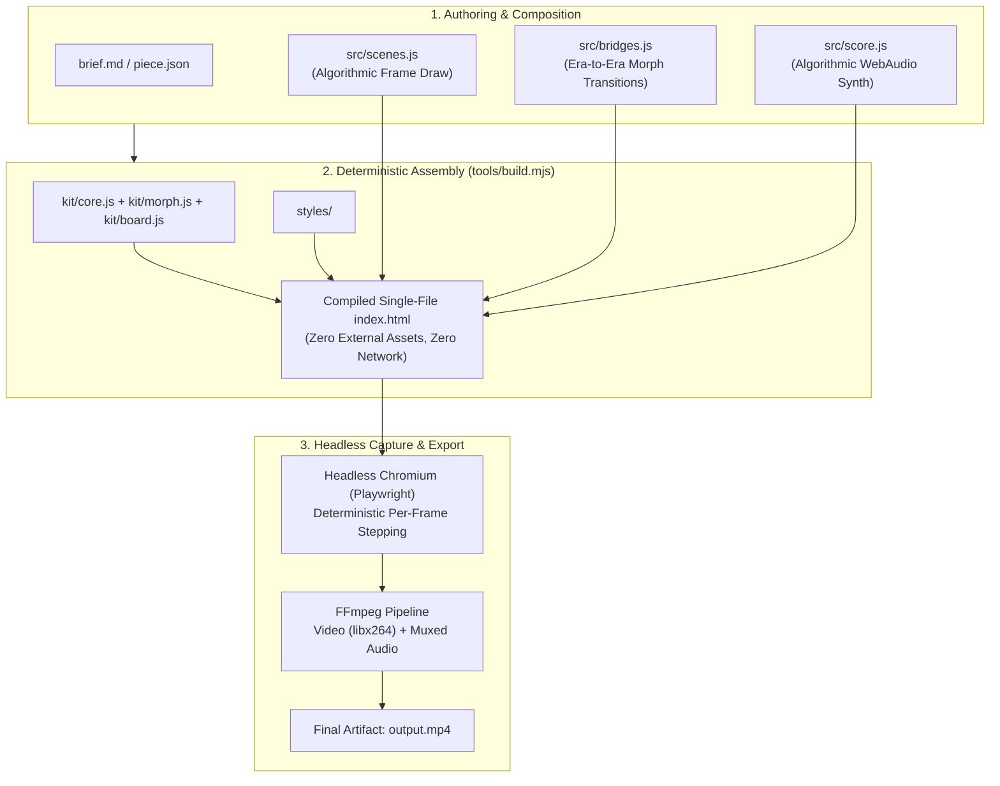
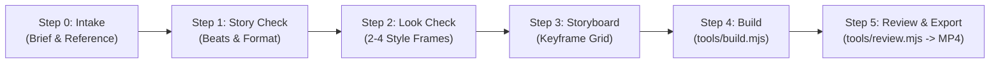

# 🎬 `animate`: Procedural Canvas Animation & Algorithmic Scoring Engine

The `animate` skill enables autonomous procedural video generation entirely from code. It produces broadcast-ready explainer animations, visual essays, and technical narratives rendered to deterministic, single-file HTML5 `<canvas>` containers and exported to MP4 via headless Playwright and ffmpeg.

---

## 🏛️ Core Architectural Paradigm

Unlike standard DOM-based presentation tools (e.g., GSAP/HTML slide decks) or heavy timeline video editors, `animate` operates on **pure algorithmic canvas graphics** combined with **procedural WebAudio sound synthesis**.



---

## 🎨 The 7 Native Art Styles

Every piece inherits a specialized aesthetic kit from `styles/<name>/`:

| Style Name | Aesthetic Character | Ideal Use Case | Visual Characteristics |
| :--- | :--- | :--- | :--- |
| **`cut-paper`** | Layered silhouette cutouts | Histories, conceptual essays, children's fables | Flat vector shapes, organic paper edges, subtle drop shadows, clean silhouettes. |
| **`crosshatch`** | Hand-inked editorial engraving | Documentary explainers, historical retrospectives | Fine directional hatching, line density gradients, parchment background texture. |
| **`riso`** | Multi-pass Risograph spot color | Indie culture, design manifestos, modern tech shorts | Dual spot-color inks, intentional misregistration, screen halftone grain, bold typography. |
| **`math`** | Manim-style vector coordinate plane | Educational lectures, mathematical proofs, physics | Coordinate grids, LaTeX formulas, parametric curve drawing, glowing vector paths. |
| **`pixel`** | 8-bit / 16-bit retro computing | Gaming history, software engineering stories | Strict pixel grid snapping, retro color palettes, dithered shading. |
| **`isometric`** | Axonometric architectural line art | System architecture, infrastructure, mechanical explainers | 30-degree isometric grid, isometric cubes, conveyor belts, mechanical flow. |
| **`sketchbook`** | Rough pencil and ink journal | Ideation logs, biographical notes, architectural sketches | Controlled line wobble, pencil lead texture, loose gesture fills. |

---

## 🛠️ The Deterministic Tool Suite

The skill is powered by high-density Node.js/Python CLI scripts located in `tools/`:

```
skills/animate/tools/
├── build.mjs        # Compiles piece source parts + kit + style into single index.html
├── still.mjs        # Renders single frames or multi-frame contact sheets to PNG
├── storyboard.mjs   # Generates 3x3 or 4x4 storyboard overview images
├── review.mjs       # Automated QA suite: checks contrast, duration, readability, and FPS
├── beats.mjs        # Analyzes audio transients and generates beat grids (BPM map)
├── voice.mjs        # Formats and synchronizes voice-over cues
├── export.mjs       # Headless Chromium frame recorder + FFmpeg MP4 encoder
└── gallery.mjs      # Compiles style preview tiles from all installed art kits
```

---

## ⚙️ Step-by-Step Creation Flow



### 1. Project Scaffolding
Create a piece directory under `pieces/<name>/`:
```bash
# Example piece structure
pieces/demo-explainer/
├── piece.json       # Metadata, selected style, dimensions, and FPS
├── brief.md         # Narrative premise, research facts, and core visual metaphor
└── src/
    ├── head.html    # Custom styles or canvas wrapper
    ├── scenes.js    # Scene drawing definitions (era-01, era-02, era-03)
    ├── bridges.js   # Morph bridges between scenes
    └── score.js     # Procedural synthesizer notes and BPM timing
```

### 2. Configuration (`piece.json`)
```json
{
  "name": "demo-explainer",
  "style": "cut-paper",
  "width": 1080,
  "height": 1920,
  "fps": 30,
  "duration": 25.0
}
```

### 3. Assembly & Verification
```bash
# 1. Compile into single standalone index.html
node skills/animate/tools/build.mjs pieces/demo-explainer

# 2. Render test still frames at 2.5s, 8.0s, and 15.0s
node skills/animate/tools/still.mjs pieces/demo-explainer 2.5,8.0,15.0 preview.png

# 3. Export final video
node skills/animate/tools/export.mjs pieces/demo-explainer output.mp4
```

---

## 🔒 Safety & Validation Rules

1. **Zero External Assets**: All visual rendering must execute inside standard Canvas 2D / WebGL contexts without relying on CDN font links or remote unverified image URLs.
2. **Deterministic Seeded Randomness**: Use the internal `RNG(seed)` and the boil index `B` for line jitter. Never call native unseeded `Math.random()`.
3. **Audio-Video Lockstep**: Frame step `T` drives both visual canvas draw routines and WebAudio buffer evaluation, ensuring zero drift during headless export.
4. **Integrity Baseline**: Any updates to `skills/animate/` are verified against `skills-lock.json` and audited to maintain 100/100 quality compliance.
